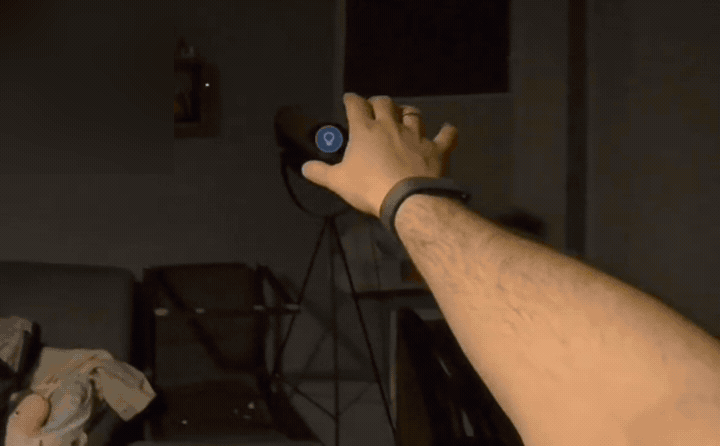

<div align="center">

# HA goes Quest

**A personal case study in playful mixed reality on Meta Quest 3**

[](CHANGELOG.md)
[](docs/documentation.md#development-and-build)
[](#about-this-case-study)

Place lights, switches, sensor readings, and picture frames in your scanned room. Select an entity with the gaze reticle and control it with a hand gesture.

[Installation](docs/INSTALLATION.md) · [Documentation](docs/README.md) · [Troubleshooting](docs/knowledgebase.md) · [Changelog](CHANGELOG.md) · [User guide](docs/USER-GUIDE-EN.md)



*Watch the full gestures: view camera snapshots, select and switch on a light, adjust its brightness, and raise or lower TV volume. The 23-second demo runs at the original speed.*

</div>

## About this case study

I wanted to explore a simple idea: could I place virtual objects around a real room and use them to control devices through an API? I chose Home Assistant because I already use it at home. HA goes Quest is the result: a personal experiment in playful spatial interaction, from switching a light with a pinch to adjusting its brightness by turning a fist.

I have tested the app successfully on my own Quest. I do not currently plan active development, though strong interest could bring me back to it. You are welcome to fork the project and continue the experiment in your own direction.

## Your home at a glance

- **Spatial entities:** Icons and sensor readings at positions you choose; camera and image entities as frames.
- **Gestures:** Gaze reticle + pinch to toggle; rotate a fist for brightness or volume. Either hand can be used, with one owning the action at a time.
- **Room visibility:** Placed entities appear only in the current scanned Quest room.
- **Find entities:** Scrollable list with current values, search, and combinable type and HA area filters.
- **Personal controls:** German/English, adjustable HA watch, sounds, and gesture hints. Optional magic mode with a fireball and practice target.
- **Retain your connection:** After successful setup, the token is stored encrypted on the Quest; compatible updates preserve credentials and placements.

## Quick start

### Prerequisites

- Meta Quest 3 with hand tracking enabled; developer mode and USB debugging for APK installation.
- A Home Assistant instance reachable from the Quest network and a Long-Lived Access Token.
- The supplied development APK; building it yourself also requires Unity with Android Build Support.

### 1. Install or update

Install using Meta Quest Developer Hub or:

```text
adb install -r HAgoesQuest-0.6.3.apk
```

Install over the existing app. **Do not uninstall or clear app data** if you want to retain the token and placements. APK uploads are manual.

### 2. Connect and capture rooms

Start the app, enter the Home Assistant base URL and token, or scan the token as a QR code. Test and save the connection. Then load existing Quest rooms or open the system room-capture dialog.

### 3. Place and control an entity

Search for an entity, filter by type and HA area if needed, choose a placement method, and confirm its position. Close the menu, aim the gaze reticle at the icon, and pinch. For brightness/volume, briefly open your hand, make a fist, and rotate it; opening the hand commits the value.

Once the fist has captured the target, you can look away while the hand remains tracked. Briefly release both hands before switching hands. [Full instructions](docs/INSTALLATION.md).

## Currently supported features

| Feature | Behavior in 0.6.3 |
| --- | --- |
| Selection | Head direction; Quest 3 has no eye tracking |
| Lights and switches | Turn `light` / `switch` on and off; dim supported lights |
| Volume | `media_player` entities that report volume support |
| Other entities | Display states; no general commands for every HA domain |
| Camera / image | Refreshed snapshots, no video/audio stream |
| Room scan | Meta room data; physical lights are mapped to HA entities manually |
| Positions | Up to 50 mappings per HA server; local Spatial Anchors |
| States | REST polling; no WebSocket live stream |
| HA watch | Adjustable wrist position; opens a stationary menu |

## Buy me a coffee

If you enjoyed this project, you can [buy me a coffee](https://www.buymeacoffee.com/alexrosbaci). It is entirely optional, and I appreciate it.

## Documentation and licensing

- [Documentation index](docs/README.md): Find instructions by task.
- [Technical reference](docs/documentation.md): Architecture, HA requests, persistence, and build instructions.
- [Knowledge base](docs/knowledgebase.md): Symptoms, causes, and practical troubleshooting.
- [Changelog](CHANGELOG.md): Concise feature history.
- [Asset provenance](docs/documentation.md#asset-provenance): Origins of the icons, effects, and sounds.

No explicit project-wide license for the original code has been selected yet. The invitation to fork and continue development does not relicense third-party components.

Meta, Unity, and other dependencies retain their respective license terms. See the bundled [third-party notices](Assets/HAgoesQuest/Resources/Legal/ThirdPartyNotices.txt), [ZXing license](Assets/Plugins/ZXing/LICENSE.txt) and [notice](Assets/Plugins/ZXing/NOTICE.md), and [QR tool license](tools/qr/LICENSE.txt). The documentation structure follows [LanLens](https://github.com/AlexRosbach/LanLens); this does not transfer its license or product commitments to HAgoesQuest.
