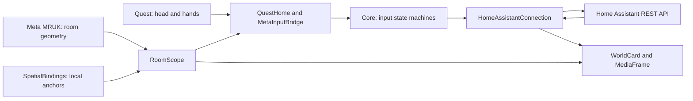

# HA goes Quest – technical reference

This reference describes the **0.6.3** source code. Introduction and installation are covered in the [README](../README.md) and [user instructions](INSTALLATION.md).

## Contents

1. [Architecture](#architecture)
2. [Input and gestures](#input-and-gestures)
3. [Rooms and anchors](#rooms-and-anchors)
4. [Home Assistant integration](#home-assistant-integration)
5. [Local data](#local-data)
6. [Development and build](#development-and-build)
7. [Asset provenance](#asset-provenance)

## Architecture

The app runs as a Unity Android application on the Quest. There is no dedicated HAgoesQuest backend service.



### Directories and responsibilities

| Path | Responsibility |
| --- | --- |
| `Assets/HAgoesQuest/Core/` | Unity-independent rules for focus, gestures, tracking, URLs, and commands |
| `Assets/HAgoesQuest/Runtime/QuestHome.cs` | App flow, menus, selection, and placement |
| `Runtime/GazeControls.cs` | Gaze selection, fist state, target capture, and feedback |
| `Runtime/InteractionRouting.cs` | Hand ownership, navigation, and menu input priority |
| `Runtime/MetaInputBridge.cs` | Official ISDK ray/poke interactors and selection events |
| `Runtime/HomeAssistantConnection.cs` | Authentication, state queries, areas, and commands |
| `Runtime/SpatialBindings.cs` | Load, save, and localize anchors; remove mappings |
| `Runtime/RoomScope.cs` | Validate the actual current room |
| `Runtime/ConnectionVault.cs` | Encrypted credentials through Android Keystore |
| `Runtime/WorldCard.cs`, `EntityScrollList.cs`, `MediaFrame.cs` | Spatial UI, reused list rows, and snapshots |
| `Assets/HAgoesQuest/Editor/` | Project setup, scene, Android manifest, and build safeguards |
| `tools/` | Build script, USB connection helper, and local QR generator |

Short `Runtime/` paths in this table refer to `Assets/HAgoesQuest/Runtime/`.

## Input and gestures

### Gaze reticle and pinch

Entity selection uses head direction. `GazeTarget()` considers visible markers up to 8 m away within a 1.7° angle; an intervening collider may prevent selection. Quest 3 does not provide eye tracking for this.

`GazePinchGate` requires a released hand before a new pinch. A short 0.12 s delay and finger posture distinguish pinching from closing a fist. A held pinch does not trigger repeatedly. SDK pointers and direct touch are also used for menus and placement.

### One hand per action

`InteractionOwnership` keeps `Owner` at `-1` (no hand), `0` (left), or `1` (right). Hand preference decides simultaneous starts. The selected hand remains fixed during an action. Only after both hands have no active input and no action is running does a 0.18 s quiet period allow another hand to take over.

The watch-hand menu pinch is available outside an entity target or menu control. An entity gesture must not open the menu simultaneously. Tapping the watch remains an alternative menu action.

### Fist adjustment and magic

1. Look at the target and maintain a recognized open hand for at least 0.18 s.
2. Close the fist: `QuestHome` captures the target and head rotation as a rotation reference.
3. Rotate the fist: after more than 12° and at least 0.12 s of holding, supported brightness/volume adjustment begins.
4. Maintain a recognized open hand for at least 0.08 s: commit the preview value once. If no adjustment occurred, opening can instead trigger a fireball when magic mode is enabled.

`GazeGestureGate` calculates a normalized value between 0 and 1. The reference stays constant when looking away. Tracking loss, invalid samples, or a sampling gap over 0.25 s reset gesture state; they do not count as opening the fist. A room or menu change discards the captured target. Adjustment ticks accompany value changes, not merely holding.

### Navigation and lists

`NavigationReleaseGate` blocks input for at least 0.2 s after navigation and requires 0.12 s without active touch or pinch. `MetaInputBridge.Cancel()` discards pending selection events. A directly touched menu button is handled before the list.

The list uses ten recycled rows, eight fully visible. Only fully visible rows have active colliders. On release, the initially pressed entity ID must still belong to that row; recycling a row while scrolling must not cause accidental selection.

## Rooms and anchors

**HA areas** organize entities in the list. **Quest rooms** describe physical boundaries. Matching names do not create an automatic connection between the systems.

`RoomScope` accepts the room reported by MRUK only if the head is inside its boundaries; otherwise it checks the loaded rooms. Markers must be in the same room. Without a valid room, placed entities are hidden and commands blocked. Demo mode and the editor without room data have an explicit exception in code.

`SpatialBindings` loads saved anchors after headset tracking stabilizes. An anchor must be localized, tracked, and stable for at least 0.75 s. Position changes over 3 cm or rotations over 3° restart the stability check. Missing anchors are retried after 15 s; localization across different rooms runs in parallel.

During placement, the tracking epoch is checked before and after asynchronous SDK calls. Recalibration between these steps prevents committing an outdated position. The mapping file is updated only after the anchor is saved. Deletion removes the local mapping first, so an unlocatable room anchor cannot block interaction.

Stability checks cannot reliably detect a room that the operating system has localized stably but incorrectly.

## Home Assistant integration

### Requests

All requests go to the configured base URL, use a bearer token and an 8 s timeout, and do not follow redirects. HTTPS uses normal certificate validation. HTTP requires explicit opt-in and also transmits credentials unencrypted.

| Request | Purpose |
| --- | --- |
| `GET /api/states` | Test the connection and load entity states |
| `POST /api/template` | Area catalog using `areas()`, `area_name()`, and `area_entities()` |
| `POST /api/services/light/turn_on` or `turn_off` | Switch a light; `turn_on` with `brightness_pct` also dims |
| `POST /api/services/switch/turn_on` or `turn_off` | Operate a switch |
| `POST /api/services/media_player/volume_set` | Set supported volume with `volume_level` between 0 and 1 |
| `GET /api/camera_proxy/{entity_id}` | Camera image through the HA server |
| `GET /api/image_proxy/{entity_id}` | Image entity through the HA server |

This is the subset used by the app, not a general HA API reference. Current API specification: [Home Assistant REST API](https://developers.home-assistant.io/docs/api/rest/).

### Fresh data and commands

Online state queries are followed by a pause of approximately 1.5 s, or approximately 5 s offline; response time is additional. A snapshot is fresh only when `Online` and less than 6 s old. No other commands are accepted while a command is running. A state query started before a command must not overwrite its newer state.

Switching explicitly uses `turn_on` or `turn_off`, not a blind `toggle`. Commands are not automatically retried after timeout because HA may already have executed them. The app requests a new state after each command.

All valid domains can be displayed. Switching is restricted to `light` and `switch` in state `on` or `off`. Dimmability is derived from `supported_color_modes`; volume support from bitmask `4` of `supported_features`. There is no general service call for arbitrary domains.

### Areas and media

Areas load independently of the filtered entity list; empty areas remain selectable. The client commits only a fully parsed catalog, then increments `AreaRevision` to refresh an open selector. An invalid response does not replace a previously valid catalog for the same connection.

`MediaFrame` limits concurrent requests to two. Cameras wait at least 0.5 s after each response; image entities wait 10 s. Hidden, distant, or out-of-view frames do not continuously fetch. Decodable images below 8 MiB and no larger than 4096 × 4096 pixels are accepted. Arbitrary `entity_picture` URLs are not requested with the token.

## Local data

| Data | Storage and meaning |
| --- | --- |
| Credentials | `connection.secure.json` in `Application.persistentDataPath`; AES-GCM with Android Keystore alias `HAgoesQuest.connection.v1` |
| Optional import | `connection.json`; removed after successful validation and encrypted storage |
| Placements | `bindings-<Serverhash>.json`, format version 1; SHA-256 of server identity truncated to 24 hexadecimal characters |
| Placement entry | `entityId`, `anchorUuid`, `displayOnly`; no saved world coordinates as an anchor substitute |
| General settings | Unity `PlayerPrefs`, prefix `HAgoesQuest.experience.` |
| Watch | Separate local wrist settings; see `WatchPlacement.cs` |

Maximum 50 placements per server. Writes first go to a temporary file; replacing mappings creates a `.bak` file. Invalid mapping files are not silently overwritten.

An empty token field may reuse stored credentials only for the same normalized base URL. Scheme, host, and port are part of the identity. Another server requires its own credentials and receives separate mappings.

### Optional USB import

Normal setup takes place in the app. On Windows, the helper script can alternatively transfer configuration to an authorized Quest and prompt for the token without displaying it:

```powershell
.\tools\Connect-Quest.ps1 -BaseUrl 'https://your-home-assistant.example'
```

Add `-Adb '<path to adb.exe>'` if needed and `-Device '<serial number>'` for multiple devices. Local HTTP additionally requires `-AllowInsecureHttp`. The [configuration example](connection.example.json) describes manual-import fields. `connection.json` is normally located under `/sdcard/Android/data/com.alexrosbach.hagoesquest/files/` and contains plaintext until successful migration. Do not commit it.

Updates require the same package name, `com.alexrosbach.hagoesquest`, a matching signing key, and a higher Android version code. Alias and data formats may change only with a migration. Uninstalling or clearing app data removes the basis for reuse. The editor does not persist access tokens through `ConnectionVault`.

## Development and build

### Tool baseline

| Component | Pinned project version |
| --- | --- |
| Unity | 6000.0.66f2 |
| Meta XR Core / Interaction SDK / MRUK | 207.0.0 |
| Target | Android ARM64, IL2CPP, development build |
| Minimum Android API | 32 |
| Rendering | Built-in Render Pipeline |

### Unity workflow

Development uses **Unity Personal** as the maintainer’s working assumption for this playful Home Assistant experience on Meta Quest. This records the project setup assumption; it is not an independently verified legal clearance.

1. Open the project directory in Unity Hub. Install Android Build Support with SDK, NDK, and OpenJDK; activate a license.
2. Complete package import. Select Android as the build target.
3. Run **HA goes Quest → 1 - Projekt konfigurieren** (configure project), then **2 - Startszene erstellen** (create startup scene). An existing scene is opened. These menu labels are the current editor labels.
4. Check the OpenXR loader, Meta XR feature set, and Oculus Touch interaction profiles; run Unity Project Validation and Meta Project Setup Tool.
5. Run **HA goes Quest → 3 - Entwicklungs-APK bauen** (build development APK). Output: `Builds/HAgoesQuest.apk`.

Alternatively, on Windows:

```powershell
.\tools\Build-Quest.ps1 -Unity 'U:\Unity\6000.0.66f2\Editor\Unity.exe' -CacheRoot 'U:\HAgoesQuestCache'
```

Adjust paths to your machine. The script checks the signing key against previous development APKs. Another developer needs a deliberately separate signing/package process; do not silently replace a missing original key.

`PrivateBuildSettings` temporarily moves local SDK connection data to an editor-only path after the SDK build callback. The packed asset report must confirm its exclusion. The file is then moved back. These contents must not be logged or included in source archives or Git.

## Asset provenance

The lamp, map, sensor, and switch PNG icons and the green fireball texture were generated with OpenAI Imagegen. The original transparent PNGs are retained; Unity imports them at up to 512 pixels. Geometric UI elements, click sounds, fireball motion, and trails are generated by app code.

Third-party components retain their own terms. See the [bundled notices](../Assets/HAgoesQuest/Resources/Legal/ThirdPartyNotices.txt), [ZXing license](../Assets/Plugins/ZXing/LICENSE.txt) and [notice](../Assets/Plugins/ZXing/NOTICE.md), and [QR helper license](../tools/qr/LICENSE.txt).
