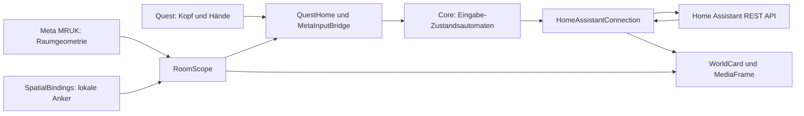

# HA goes Quest – technische Referenz

Diese Referenz beschreibt den Quellcode von **0.6.3**. Die Einführung und Installation stehen in der [README](../README.md) und der [Bedienungsanleitung](INSTALLATION.md).

## Inhalt

1. [Architektur](#architektur)
2. [Eingabe und Gesten](#eingabe-und-gesten)
3. [Räume und Anker](#räume-und-anker)
4. [Home-Assistant-Anbindung](#home-assistant-anbindung)
5. [Lokale Daten](#lokale-daten)
6. [Entwicklung und Build](#entwicklung-und-build)
7. [Prüfungen](#prüfungen)

## Architektur

Die App läuft als Unity-Android-Anwendung auf der Quest. Es gibt keinen eigenen HAgoesQuest-Backenddienst. Der lokale HA-Testserver gehört ausschließlich zur Testumgebung.



### Verzeichnisse und Zuständigkeiten

| Pfad | Aufgabe |
| --- | --- |
| `Assets/HAgoesQuest/Core/` | Unity-unabhängige Regeln für Fokus, Gesten, Tracking, URLs und Befehle |
| `Assets/HAgoesQuest/Runtime/QuestHome.cs` | App-Ablauf, Menüs, Auswahl und Platzierung |
| `Runtime/GazeControls.cs` | Blickauswahl, Faustzustand, Zielbindung und Rückmeldung |
| `Runtime/InteractionRouting.cs` | Handübernahme, Navigation und Priorität der Menübedienung |
| `Runtime/MetaInputBridge.cs` | Offizielle ISDK-Ray-/Poke-Interaktoren und Auswahlereignisse |
| `Runtime/HomeAssistantConnection.cs` | Anmeldung, Zustandsabfragen, Bereiche und Befehle |
| `Runtime/SpatialBindings.cs` | Anker laden, speichern, lokalisieren und Zuordnungen entfernen |
| `Runtime/RoomScope.cs` | Prüfung des tatsächlichen aktuellen Raums |
| `Runtime/ConnectionVault.cs` | Verschlüsselte Anmeldung über Android Keystore |
| `Runtime/WorldCard.cs`, `EntityScrollList.cs`, `MediaFrame.cs` | Räumliche UI, wiederverwendete Listenzeilen und Einzelbilder |
| `Assets/HAgoesQuest/Editor/` | Projektkonfiguration, Szene, Android-Manifest und Build-Schutz |
| `Assets/HAgoesQuest/Testing/` | Unity-Integrationsprüfungen und UI-Vorschau |
| `tests/`, `tools/` | Unabhängige Tests, HA-Mockserver sowie Build-/Installationsskripte |

Die kurzen `Runtime/`-Pfade in dieser Tabelle beziehen sich auf `Assets/HAgoesQuest/Runtime/`.

## Eingabe und Gesten

### Blickpunkt und Pinch

Die Entitätsauswahl verwendet die Kopf-Blickrichtung. `GazeTarget()` berücksichtigt sichtbare Marker bis 8 m Entfernung innerhalb eines Winkels von 1,7°; ein vorgeschalteter Collider kann die Auswahl verhindern. Die Quest 3 liefert dafür kein Eye-Tracking.

`GazePinchGate` verlangt eine gelöste Hand vor einem neuen Pinch. Eine kurze Verzögerung von 0,12 s und die Fingerhaltung unterscheiden Pinchen vom Schließen einer Faust. Ein gehaltener Pinch löst nicht wiederholt aus. Für Menü und Platzierung werden zusätzlich SDK-Zeiger und direktes Antippen verwendet.

### Eine Hand pro Aktion

`InteractionOwnership` hält `Owner` auf `-1` (keine Hand), `0` (links) oder `1` (rechts). Bei gleichzeitigem Beginn entscheidet die Handpräferenz. Während eines laufenden Vorgangs bleibt die Hand fest gewählt. Erst wenn beide Hände ohne aktive Eingabe sind und kein Vorgang mehr läuft, gibt eine Ruhephase von 0,18 s die Übernahme frei.

Der Menü-Pinch der Uhrenhand steht außerhalb eines Entitätsziels bzw. Menübedienelements zur Verfügung. Eine Entitätsgeste darf nicht gleichzeitig das Menü öffnen. Das Antippen der Uhr bleibt eine alternative Menüaktion.

### Faustregler und Magie

1. Ziel ansehen und die offene Hand mindestens 0,18 s stabil erkennen lassen.
2. Faust schließen: `QuestHome` hält Ziel und Kopfrotation als Drehreferenz fest.
3. Faust drehen: nach mehr als 12° Drehung und mindestens 0,12 s Haltezeit beginnt eine unterstützte Helligkeits-/Lautstärkeregelung.
4. Hand mindestens 0,08 s geöffnet erkennen: den Vorschauwert einmal übernehmen. Ohne Regelung kann bei aktivem Magiemodus stattdessen ein Feuerball ausgelöst werden.

`GazeGestureGate` berechnet den normierten Wert zwischen 0 und 1. Die Referenz bleibt beim Wegschauen konstant. Trackingverlust, ungültige Messwerte oder eine Messpause über 0,25 s setzen den Gestenzustand zurück; sie zählen nicht als Öffnen der Faust. Ein Raumwechsel oder Menüwechsel verwirft das festgehaltene Ziel. Rastergeräusche begleiten Wertänderungen, nicht das bloße Halten.

### Navigation und Listen

`NavigationReleaseGate` sperrt Eingaben nach einem Seitenwechsel für mindestens 0,2 s und verlangt 0,12 s ohne aktive Berührung oder Pinch. `MetaInputBridge.Cancel()` verwirft noch offene Auswahlereignisse. Ein direkt angetippter Menübutton wird vor der Liste behandelt.

Die Liste verwendet zehn wiederverwendete Zeilen, davon acht vollständig sichtbar. Nur vollständig sichtbare Zeilen erhalten aktive Collider. Beim Loslassen muss die ursprünglich gedrückte Entitäts-ID noch zur Zeile gehören; eine während des Scrollens neu belegte Zeile darf nicht versehentlich ausgewählt werden.

## Räume und Anker

**HA-Bereiche** ordnen Entitäten in der Liste. **Quest-Räume** beschreiben physische Grenzen. Gleichlautende Namen erzeugen keine automatische Verbindung zwischen beiden Systemen.

`RoomScope` akzeptiert den von MRUK gemeldeten Raum nur, wenn der Kopf innerhalb seiner Grenzen liegt; andernfalls werden die geladenen Räume geprüft. Marker müssen im selben Raum liegen. Ohne gültigen Raum werden platzierte Entitäten ausgeblendet und Befehle gesperrt. Demo und Editor ohne Raumdaten haben eine ausdrücklich im Code definierte Ausnahme.

`SpatialBindings` lädt gespeicherte Anker nach stabilem Headset-Tracking. Ein Anker muss lokalisiert, getrackt und mindestens 0,75 s stabil sein. Positionsänderungen über 3 cm oder Rotationen über 3° beginnen die Stabilitätsprüfung erneut. Fehlende Anker werden nach 15 s erneut gesucht; die Lokalisierung verschiedener Räume läuft parallel.

Beim Platzieren wird die Tracking-Epoche vor und nach asynchronen SDK-Aufrufen geprüft. Eine Neukalibrierung zwischen diesen Schritten verhindert die Übernahme einer veralteten Position. Die Zuordnungsdatei wird erst nach dem Speichern des Ankers aktualisiert. Beim Löschen wird die lokale Zuordnung zuerst entfernt, damit ein nicht auffindbarer Raumanker die Bedienung nicht blockiert.

Stabilitätsprüfungen können einen vom Betriebssystem stabil, aber falsch lokalisierten Raum nicht zuverlässig erkennen. Die [Hardware-Abnahme](QUEST-TEST.md) bleibt notwendig.

## Home-Assistant-Anbindung

### Anfragen

Alle Anfragen gehen an die konfigurierte Basisadresse, verwenden einen Bearer-Token, ein Timeout von 8 s und folgen keinen Weiterleitungen. HTTPS nutzt die reguläre Zertifikatsprüfung. HTTP verlangt ausdrückliche Freigabe; damit werden auch Zugangsdaten unverschlüsselt übertragen.

| Anfrage | Zweck |
| --- | --- |
| `GET /api/states` | Verbindung prüfen und Entitätszustände laden |
| `POST /api/template` | Bereichskatalog über `areas()`, `area_name()` und `area_entities()` |
| `POST /api/services/light/turn_on` bzw. `turn_off` | Lampe schalten; `turn_on` mit `brightness_pct` auch zum Dimmen |
| `POST /api/services/switch/turn_on` bzw. `turn_off` | Schalter bedienen |
| `POST /api/services/media_player/volume_set` | Unterstützte Lautstärke mit `volume_level` zwischen 0 und 1 setzen |
| `GET /api/camera_proxy/{entity_id}` | Kamerabild über den HA-Server |
| `GET /api/image_proxy/{entity_id}` | Bildentität über den HA-Server |

Dies ist die von der App verwendete Teilmenge, keine allgemeine HA-API-Referenz. Aktuelle API-Spezifikation: [Home Assistant REST API](https://developers.home-assistant.io/docs/api/rest/).

### Frische Daten und Befehle

Online folgt auf eine Zustandsabfrage eine Pause von etwa 1,5 s, offline etwa 5 s; die Antwortzeit kommt hinzu. Ein Snapshot gilt nur bei `Online` und einem Alter unter 6 s als frisch. Während eines Befehls werden keine weiteren Befehle angenommen. Eine vor dem Befehl gestartete Zustandsabfrage darf dessen neueren Zustand nicht überschreiben.

Schalten verwendet ausdrücklich `turn_on` oder `turn_off`, kein blindes `toggle`. Befehle werden bei Timeout nicht automatisch wiederholt, weil HA sie bereits ausgeführt haben könnte. Nach jedem Befehl fordert die App einen neuen Zustand an.

Alle gültigen Domänen können angezeigt werden. Schalten ist auf `light` und `switch` in Zustand `on` oder `off` begrenzt. Dimmbarkeit wird aus `supported_color_modes`, Lautstärkeregelung aus der Bitmaske `4` von `supported_features` abgeleitet. Es gibt keinen allgemeinen Serviceaufruf für beliebige Domänen.

### Bereiche und Medien

Bereiche werden unabhängig von der gefilterten Entitätsliste geladen; leere Bereiche bleiben auswählbar. Der Client übernimmt erst den vollständig geparsten Katalog und erhöht danach `AreaRevision`, damit eine offene Auswahl aktualisiert wird. Eine fehlerhafte Antwort ersetzt keinen bereits gültigen Katalog derselben Verbindung.

`MediaFrame` begrenzt gleichzeitige Anfragen auf zwei. Kameras warten nach jeder Antwort mindestens 0,5 s, Bildentitäten 10 s. Verborgene, zu weit entfernte oder außerhalb der Blickrichtung liegende Rahmen laden nicht ständig weiter. Akzeptiert werden dekodierbare Bilder unter 8 MiB mit höchstens 4096 × 4096 Pixeln. Es wird keine beliebige `entity_picture`-URL mit dem Token aufgerufen.

## Lokale Daten

| Daten | Speicher und Bedeutung |
| --- | --- |
| Anmeldung | `connection.secure.json` in `Application.persistentDataPath`; AES-GCM mit Android-Keystore-Alias `HAgoesQuest.connection.v1` |
| Optionaler Import | `connection.json`; wird nach erfolgreicher Prüfung und verschlüsselter Speicherung entfernt |
| Platzierungen | `bindings-<Serverhash>.json`, Formatversion 1; SHA-256 der Serveridentität, auf 24 Hexzeichen gekürzt |
| Eintrag einer Platzierung | `entityId`, `anchorUuid`, `displayOnly`; keine gespeicherten Weltkoordinaten als Ankerersatz |
| Allgemeine Einstellungen | Unity `PlayerPrefs`, Präfix `HAgoesQuest.experience.` |
| Uhr | Getrennte lokale Handgelenk-Einstellungen; siehe `WatchPlacement.cs` |

Maximal 50 Platzierungen pro Server. Schreiben erfolgt zunächst in eine temporäre Datei; beim Ersetzen der Zuordnungen entsteht eine `.bak`-Datei. Ungültige Zuordnungsdateien werden nicht stillschweigend überschrieben.

Ein leeres Tokenfeld darf nur für dieselbe normalisierte Basisadresse die gespeicherte Anmeldung verwenden. Schema, Host und Port gehören zur Identität. Ein anderer Server erfordert eine eigene Anmeldung und erhält getrennte Zuordnungen.

### Optionaler USB-Import

Die reguläre Einrichtung erfolgt in der App. Unter Windows kann alternativ das Hilfsskript die Konfiguration auf eine autorisierte Quest übertragen und den Token verdeckt abfragen:

```powershell
.\tools\Connect-Quest.ps1 -BaseUrl 'https://dein-home-assistant.example'
```

Bei Bedarf `-Adb '<Pfad zur adb.exe>'` und bei mehreren Geräten `-Device '<Seriennummer>'` ergänzen. Für lokales HTTP ist zusätzlich `-AllowInsecureHttp` nötig. Die [Konfigurationsvorlage](connection.example.json) beschreibt die Felder für einen manuellen Import. `connection.json` liegt dabei normalerweise unter `/sdcard/Android/data/com.alexrosbach.hagoesquest/files/` und enthält bis zur erfolgreichen Migration Klartext. Nicht ins Repository aufnehmen.

Updates benötigen denselben Paketnamen `com.alexrosbach.hagoesquest`, einen passenden Signaturschlüssel und einen höheren Android-Versionscode. Alias und Datenformate dürfen nur mit einer Migration geändert werden. Deinstallation oder Löschen der App-Daten entfernt die Grundlage für die Wiederverwendung. Der Editor speichert keine Zugangstoken über `ConnectionVault`.

## Entwicklung und Build

### Werkzeugbasis

| Komponente | Festgelegter Projektstand |
| --- | --- |
| Unity | 6000.0.66f2 |
| Meta XR Core / Interaction SDK / MRUK | 207.0.0 |
| Ziel | Android ARM64, IL2CPP, Entwicklungsbuild |
| Mindest-Android-API | 32 |
| Rendering | Built-in Render Pipeline |

### Unity-Ablauf

1. Projektordner in Unity Hub öffnen. Android Build Support mit SDK, NDK und OpenJDK installieren; Lizenz aktivieren.
2. Paketimport abschließen. Android als Build-Ziel auswählen.
3. **HA goes Quest → 1 - Projekt konfigurieren**, danach **2 - Startszene erstellen** ausführen. Eine vorhandene Szene wird geöffnet.
4. OpenXR-Loader, Meta-XR-Feature-Set und Oculus-Touch-Interaction-Profile prüfen; Unity Project Validation und Meta Project Setup Tool ausführen.
5. **HA goes Quest → 3 - Entwicklungs-APK bauen**. Ergebnis: `Builds/HAgoesQuest.apk`.

Alternativ unter Windows:

```powershell
.\tools\Build-Quest.ps1 -Unity 'U:\Unity\6000.0.66f2\Editor\Unity.exe' -CacheRoot 'U:\HAgoesQuestCache'
```

Die Pfade an den eigenen Rechner anpassen. Das Skript prüft den Signaturschlüssel gegen die bisherigen Entwicklungs-APKs. Ein anderer Entwickler benötigt einen bewusst getrennten Signatur-/Paketprozess; einen fehlenden Originalschlüssel nicht stillschweigend ersetzen.

`PrivateBuildSettings` verschiebt lokale SDK-Verbindungsdaten nach dem SDK-Buildcallback vorübergehend in einen Editor-only-Pfad. Der gepackte Asset-Bericht muss ihren Ausschluss bestätigen. Die Datei wird anschließend zurückverschoben. Diese Inhalte dürfen weder geloggt noch in Quellarchive oder Git übernommen werden.

## Prüfungen

| Prüfung | Aufruf / Nachweis | Aussage |
| --- | --- | --- |
| App-Kern | `tests/Run-Tests.ps1` oder `dotnet run --project tests/CoreTests.csproj` | Zustandsautomaten, Eingaberegeln, Service-/URL-Policy |
| Unity-Integration | `tools/Test-Network.ps1 -Unity '<Pfad zur Unity.exe>'` | Echter Client gegen lokalen HA-Mockserver, SDK-Interaktion und UI-Fixtures |
| UI-Vorschau | `HAgoesQuest.Testing.UiPreview.Run` mit `HA_QUEST_UI_PREVIEW` als absolutem PNG-Ausgabepfad | Menübilder frontal/seitlich und Handeffekt; kein Stereo-Gerätetest |
| APK | [Buildbericht](BUILD-STATUS.md) und [Prüfbericht](APK-VERIFICATION.txt) | Signatur, Paket, ARM64-Bibliotheken und Manifest der gebauten Datei |
| Quest | [QUEST-TEST.md](QUEST-TEST.md) | Physische Räume, Handtracking, Keystore, Update und Darstellung |

Der Unity-Testserver bindet an `127.0.0.1:18123`; Tests verwenden keine echten HA-Zugangsdaten. GitHub Actions führt Kernprüfungen aus, erstellt aber keine APK. Kommentare und Dokumentationsänderungen allein benötigen keinen erneuten APK-Build; ihre Prüfung wird getrennt vom historischen Buildbericht dokumentiert.
